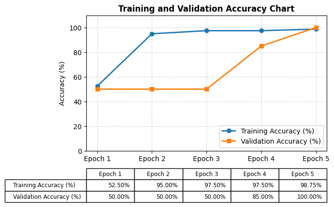
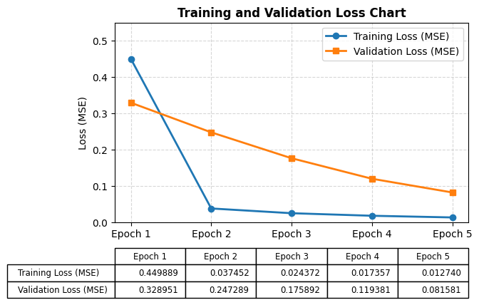

# Single Layer Perceptron (SLP) for Iris Dataset Binary Classification

Repository ini berisi implementasi dan eksperimen algoritma **Single Layer Perceptron (SLP)** untuk klasifikasi biner pada dataset bunga Iris (*Setosa* vs *Versicolor*). Eksperimen dilakukan melalui dua pendekatan: pengolahan spreadsheet (Google Sheets / Microsoft Excel) dan pemrograman Python.

---

## Deskripsi Proyek
Proyek ini bertujuan untuk memahami mekanisme kerja jaringan saraf tiruan sederhana (Single Layer Perceptron) dalam mempelajari pola data melalui:
1. **Feedforward Processing**: Menghitung kombinasi linear $z$ dan fungsi aktivasi Sigmoid $g(z)$.
2. **Gradient Descent**: Memperbaiki nilai bias ($b = 0.5$) dan bobot ($\theta_1, \theta_2, \theta_3, \theta_4 = 0.5$) secara bertahap setelah setiap sampel data latih diproses.
3. **Cross-Sheet Validation**: Menguji ketangguhan bobot hasil training terhadap 20 data uji baru pada validation set tanpa mengubah nilai bobot (*weights locked*).

---

## Ringkasan Hasil Eksperimen (5 Epoch)

Kalkulasi manual pada Google Sheets dan eksekusi otomatis script Python telah **diverifikasi 100% identik** pada setiap epoch:

| Epoch | Training Loss (MSE) | Training Accuracy (%) | Validation Loss (MSE) | Validation Accuracy (%) |
| :---: | :---: | :---: | :---: | :---: |
| Epoch 1 | 0.4499 | 52.50% | 0.3290 | 50.00% |
| Epoch 2 | 0.0375 | 95.00% | 0.2473 | 50.00% |
| Epoch 3 | 0.0244 | 97.50% | 0.1759 | 50.00% |
| Epoch 4 | 0.0174 | 97.50% | 0.1194 | 85.00% |
| Epoch 5 | 0.0127 | 98.75% | 0.0816 | **100.00%** |

---

## Visualisasi Grafik Performa

Grafik di bawah ini dihasilkan menggunakan pustaka `matplotlib` pada script Python dengan data table terintegrasi di bagian bawah chart untuk menyamai tampilan visual Google Sheets.

### 1. Accuracy Chart (Training vs Validation)

### 2. Loss Chart (Training vs Validation)

---

## Struktur Repositori & Berkas

- `SLP_iris_classification.ipynb` : Script/Notebook Python untuk pelatihan, validasi, dan visualisasi grafik dengan data table.
- `PMM-TemplateSLP.xlsx` : File Excel berisi perhitungan rumus `SLP-Training`, `SLP-Validation`, dan `Resume`.
- `page3_accuracy_chart_python.png` : Gambar grafik akurasi hasil ekspor script Python.
- `page5_loss_chart_python.png` : Gambar grafik loss hasil ekspor script Python.
- `README.md` : Dokumentasi utama proyek.

---

## Referensi (References)

1. **Materi Kuliah Utama:**  
   Afiahayati. (2026). *Linear Classifier – Single Layer Perceptron* [Slide Presentasi Perkuliahan]. Departemen Ilmu Komputer dan Elektronika, Universitas Gadjah Mada.  
   URL: [Google Drive Folder](https://drive.google.com/drive/folders/1mRsriHV10VlcOX6YJACCTiAavkXJOSe1)

2. **Dataset & Benchmark Spreadsheet:**  
   Departemen Ilmu Komputer dan Elektronika UGM. (2026). *Iris Dataset & Template Perhitungan SLP Binary Classification* [Google Sheets].  
   URL: [Google Sheets Dataset](https://docs.google.com/spreadsheets/d/1yhi8ASebpmljJ3NpYQ7NmxlWLmhGOI6W/edit?usp=sharing)
